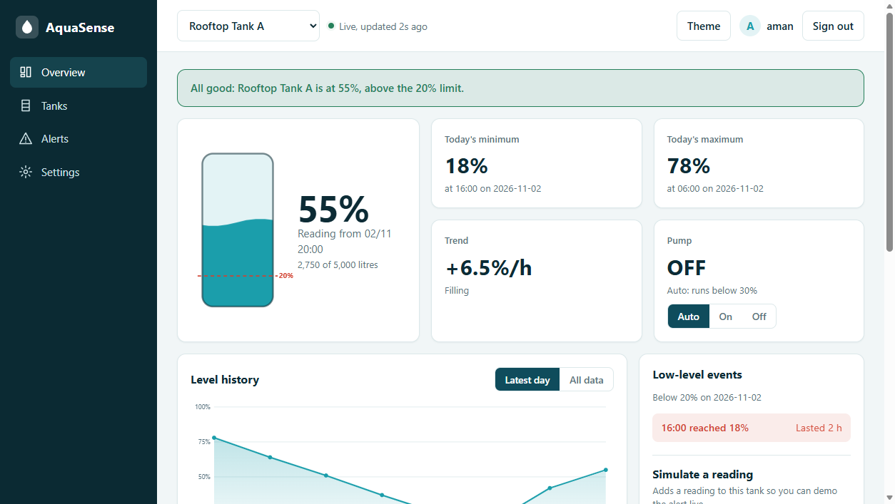
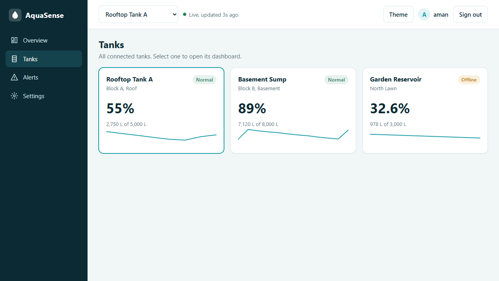
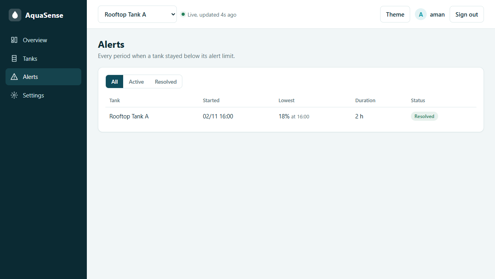
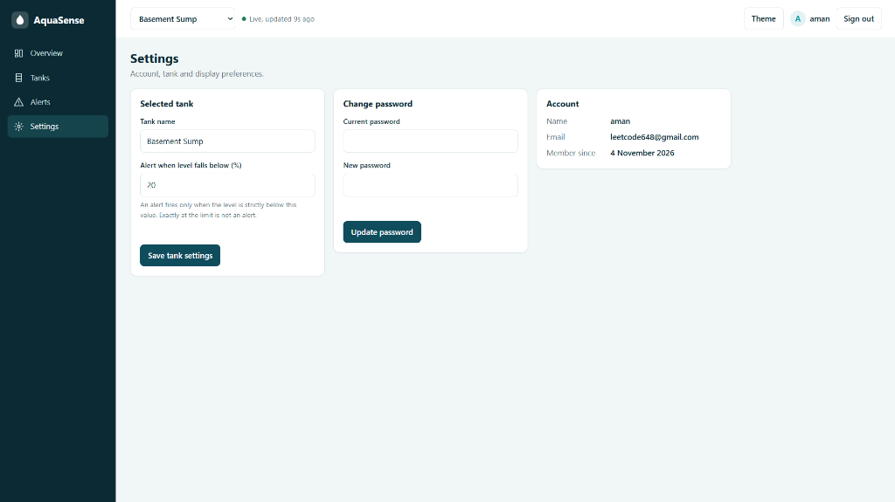
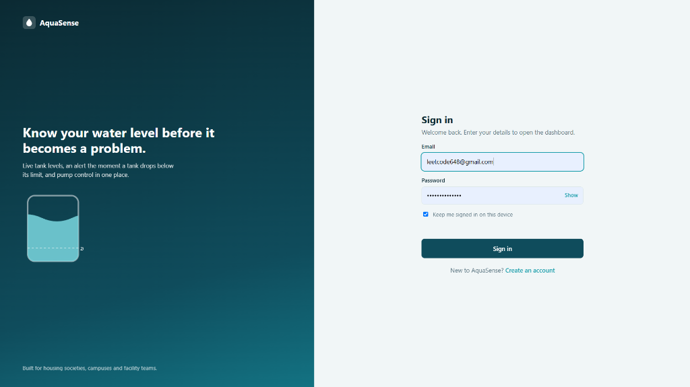
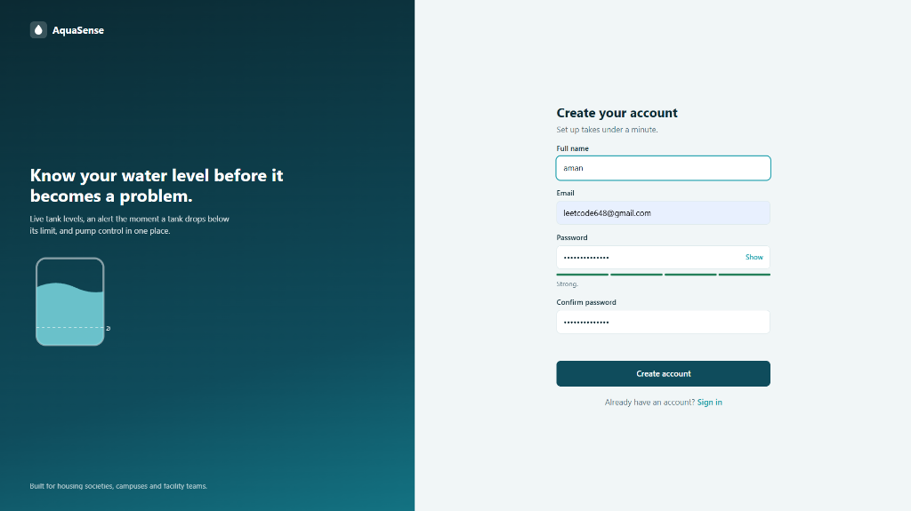

# AquaSense – Smart Water Tank Monitoring System

AquaSense is a full-stack web application that helps users monitor and manage their water tanks through a simple dashboard. It includes user authentication, water-level monitoring, low-level alerts, multiple tank management, alert history, and pump control.

The application also provides a REST API and an automated test suite to ensure everything works correctly.

The backend is built entirely using Python's standard library, while the frontend uses plain HTML, CSS, and JavaScript. No external frontend libraries are required.

<<<<<<< HEAD
=======
## Screenshots

### Live Monitoring Dashboard


### Multi-Tank Management & Alerts
| Multi-Tank Overview | Low-Level Alert History |
| :---: | :---: |
|  |  |

### Tank Settings & Preferences


### User Authentication
| Sign In | Create Account |
| :---: | :---: |
|  |  |


>>>>>>> 78a31c7 (Updated code)
## Quick Start

You only need Python 3.9 or above to run the application.

```bash
<<<<<<< HEAD
=======
cd aquasense-pro
>>>>>>> 78a31c7 (Updated code)
python server.py
```

Open `http://localhost:8000` in your browser.

For a live demonstration with simulated readings:

```bash
<<<<<<< HEAD
=======
cd aquasense-pro
>>>>>>> 78a31c7 (Updated code)
AQUA_SIMULATE=1 python server.py
```

To run the automated tests:

```bash
<<<<<<< HEAD
=======
cd aquasense-pro
>>>>>>> 78a31c7 (Updated code)
pip install pytest
pytest -v
```

The project currently includes 75 tests.

To run using Docker:

```bash
<<<<<<< HEAD
=======
cd aquasense-pro
>>>>>>> 78a31c7 (Updated code)
docker build -t aquasense .
docker run -p 8000:8000 -e AQUA_SECRET=change-me -v aqua:/data aquasense
```

Create an account to access the dashboard. Use **Simulate a Reading** or **Drain to 15%** to test low-water alerts.

## Key Features

- **User Authentication:** Secure registration and login, password hashing, token-based authentication, and login rate limiting.
- **Dashboard:** Displays current water level, today's minimum and maximum readings, water-level trends, and pump status.
- **Low-Level Alerts:** Notifies users whenever the water level falls below the configured threshold.
- **Multiple Tanks:** Supports three demo tanks, including one offline device.
- **Alert History:** Tracks low-water events, their duration, lowest recorded level, and resolution status.
- **Pump Control:** Supports automatic and manual On/Off modes.
- **Settings:** Allows users to rename tanks, change alert thresholds, and update passwords.
- **Data Export:** Download water-level readings as CSV files.
- **Responsive UI:** Includes light and dark themes, mobile navigation, and accessibility support.
- **Security:** Uses parameterised SQL queries, input validation, HTML escaping, and security headers.

## Design Decisions

- **Today's Readings:** Calculated using the date of the latest reading in the dataset rather than the system date.
- **Alert Threshold:** Alerts are triggered only when the water level is strictly below 20%. Exactly 20% does not trigger an alert.
- **Minimum and Maximum:** If multiple readings have the same value, the earliest reading is selected.
- **Simulated Readings:** Follow the existing device timeline in 30-minute intervals.
- **Database:** SQLite stores users, tanks, and readings so that data remains available after restarting the application.
- **Pump Automation:** In Auto mode, the pump starts when the water level drops below 30%. Manual On/Off controls override automatic operation.

## REST API

All endpoints except registration, login, and health check require Bearer token authentication.

| Method | Endpoint | Purpose |
|---|---|---|
| POST | `/api/signup` | Register a new user |
| POST | `/api/login` | Authenticate a user |
| POST | `/api/refresh` | Renew authentication token |
| GET | `/api/me` | Retrieve user details |
| POST | `/api/me/password` | Change password |
| GET | `/api/devices` | Get all tanks |
| GET | `/api/devices/{id}` | Get tank summary |
| GET | `/api/devices/{id}/readings?range=today` | Get today's readings |
| GET | `/api/devices/{id}/readings?range=all` | Get all readings |
| POST | `/api/devices/{id}/readings` | Add a new reading |
| POST | `/api/devices/{id}/pump` | Control the pump |
| POST | `/api/devices/{id}/settings` | Update tank settings |
| GET | `/api/devices/{id}/export.csv` | Export readings |
| GET | `/api/alerts` | View alert history |
| GET | `/device/{id}/status` | Retrieve device status |
| GET | `/api/health` | Check server health |

Example request to add a reading:

```json
{
  "level_percent": 15
}
```

Example pump control request:

```json
{
  "mode": "on"
}
```

Supported pump modes are `auto`, `on`, and `off`.

The device status API returns:

```json
{
  "level_percent": 75,
  "pump_state": "off",
  "last_seen": "2026-11-04T10:30:00"
}
```

Unknown devices return HTTP 404, while offline devices return HTTP 503.

## Project Structure

```text
<<<<<<< HEAD
server.py              Backend server and business logic
web/
  index.html           Login, registration and dashboard
  app.css              Styling and themes
  app.js               Frontend functionality
data/
  readings.json        Initial mock tank data
device_client.py       Device API client
tests/
  test_logic.py        Unit tests
  test_server.py       Integration tests
  test_device_api.py   API tests with mocked responses
Dockerfile             Docker configuration
=======
aquasense-pro/
  server.py              Backend server and business logic
  web/
    index.html           Login, registration and dashboard
    app.css              Styling and themes
    app.js               Frontend functionality
  data/
    readings.json        Initial mock tank data
  docs/
    screenshots/         Application UI screenshots and previews
  device_client.py       Device API client
  tests/
    test_logic.py        Unit tests
    test_server.py       Integration tests
    test_device_api.py   API tests with mocked responses
  Dockerfile             Docker configuration
>>>>>>> 78a31c7 (Updated code)
```

## Part B – Test Plan

I created test cases covering authentication, API responses, invalid inputs, device availability, and network failures.

| ID | Type | Test Scenario | Expected Result | Automated |
|---|---|---|---|---|
| TC-01 | Positive | Login with valid credentials | HTTP 200 with valid token | Yes |
| TC-02 | Negative | Login with incorrect password | HTTP 401/403 | Yes |
| TC-03 | Negative | Missing or invalid token | Request rejected | Yes |
| TC-04 | Positive | Request status with valid token | Correct device information | Yes |
| TC-05 | Negative | Unknown device | HTTP 404 | Yes |
| TC-06 | Negative | Offline device | HTTP 503 | Yes |
| TC-07 | Negative | Invalid API response | Rejected without crashing | Yes |
| TC-08 | Edge | Water-level boundaries | Accept 0–100%, reject invalid values | Yes |
| TC-09 | Edge | Test 19.9%, 20%, and 21% | Alert only below 20% | Yes |
| TC-10 | Edge | Test stale device readings | Stale only after 15 minutes | Yes |
| TC-11 | Negative | Network timeout | Error handled correctly | Yes |
| TC-12 | Edge | Expired authentication token | Re-authentication and retry | Manual / Future |
| TC-13 | Performance | 50 concurrent status requests | Response time within agreed SLA | Manual / Future |

The first 11 test scenarios are automated using pytest. The remaining two are planned for additional testing.

## Part B – Mobile App Losing Wi-Fi During an Operation

I would test this scenario on both a real mobile device and an emulator by disconnecting Wi-Fi while the application is performing different operations.

I would test the following situations:

1. **During Login:** Disconnect the internet while the user is logging in and check whether the application handles the failure properly.
2. **While Loading Data:** Disconnect the network while fetching tank information. The application should display an offline message instead of crashing.
3. **During Pump Control:** Disconnect the internet while switching the pump On or Off. The application should clearly communicate whether the command succeeded or failed.
4. **After Reconnection:** Check whether the application reconnects automatically and retrieves the latest device status.
5. **Network Switching:** Test switching between Wi-Fi and mobile data.
6. **Background Mode:** Disconnect the internet while the application is running in the background and reopen it after reconnecting.

I would also verify that outdated readings are clearly identified and that pump commands are never silently lost or executed twice.

Network failures can be tested using mocked responses, while real-device testing helps identify issues that automated tests might miss.

## Production Considerations

Before deploying the application in a real environment, I would make a few improvements:

- Use a strong, randomly generated `AQUA_SECRET`.
- Enable HTTPS for secure communication.
- Use secure HttpOnly cookies instead of browser storage for authentication tokens.
- Move rate-limiting information to shared storage when running multiple server processes.
- Connect actual water-level sensors instead of using simulated readings.
- Replace Python's built-in HTTP server with a production-ready server behind Nginx.

These changes would make the application more suitable for real-world usage.

## AI Usage

I used **Qoder** to assist with the initial dashboard development and automated test generation. I reviewed and modified the generated code during implementation.

**Prompts used:**

1. Build a dashboard from the provided JSON showing current water level, today's minimum and maximum, and alerts whenever the level falls below 20%.
2. Create a test plan with at least eight test cases for the login and device-status APIs and automate them using pytest with mocked responses.

**Issue I identified and fixed:**

During integration testing, I found that some write operations were sending successful HTTP responses before database transactions were committed.

Because of this, the dashboard sometimes displayed outdated information immediately after a new reading was added.

I identified the issue when an integration test added a 12% reading but the low-level alert did not appear immediately.

I fixed it by committing database changes before sending the response and improving the transaction handling for commits, rollbacks, and connection closing.

This project helped me gain practical experience in full-stack development, REST API design, authentication, database management, and automated testing.
